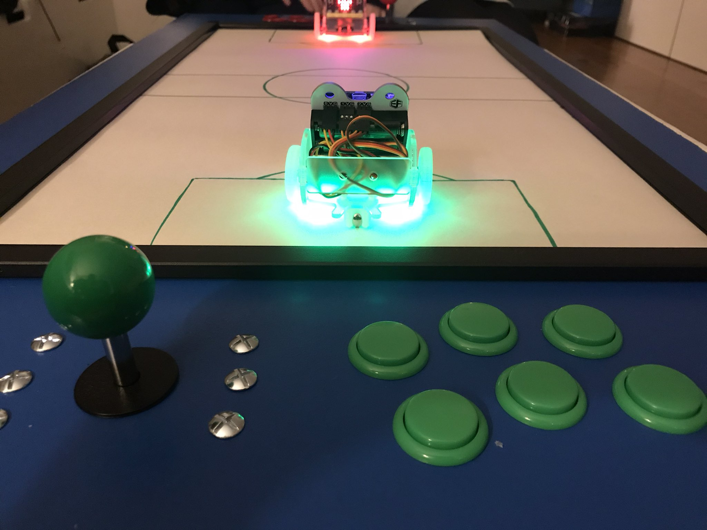

# board-explorer

An experimental interactive game board: arcade joysticks plugged into a Raspberry Pi drive micro:bit robots over Bluetooth Low Energy. Made to learn how to mix electronics with gaming.



## What it does

`board-explorer` is a small Go program for the Raspberry Pi. It connects over BLE to one or two micro:bits (one per player), reads one USB arcade joystick per player, and sends each move to that player's micro:bit as a one-letter command on the micro:bit's BLE UART. The micro:bit runs the companion MakeCode program, [board-explorer-makecode](https://github.com/storagebits/board-explorer-makecode), which drives a ring:bit car and its LEDs.

| Joystick | Command sent | On the micro:bit |
|---|---|---|
| Up | `z` | forward |
| Down | `s` | back |
| Left | `q` | turn left |
| Right | `d` | turn right |
| Button pressed | `o` | LEDs blink |
| Button released | `p` | LEDs green (blinking does not stop: see the companion repo's Status) |

## Status

Prototype, not developed since 2024. The code is provided as is, mostly for educational use.

- Worked in 2020 (as the original README reported; not re-tested on hardware since): BLE connection to up to two micro:bits, USB arcade joysticks, the commands above.
- Does not build as committed: the 2024 rewrite fails to compile against the current `golang-evdev` (`cannot use ev.Code (variable of type uint16) as int value in map index`, three times in `formatEvent`). Writing `int(ev.Code)` in those three places makes it build again. The repository also has no `go.mod` yet; see Getting started.
- Not done: the IR frame for locating pieces on the board (the touch-input reader is in the code but not wired in), RFID, scoring, LED strips and the board's furniture.

## Getting started

Requirements: a Raspberry Pi with Bluetooth (or any Linux machine with a BLE adapter), a recent Go (tested with 1.23) and a C compiler (the evdev package uses cgo), one or two micro:bits, and one USB joystick per player.

1. **Flash the micro:bits** with the companion program: open https://makecode.microbit.org/_frdR5xctm0Rt and download it to each micro:bit, or import the [board-explorer-makecode](https://github.com/storagebits/board-explorer-makecode) repository in MakeCode. Note each micro:bit's name (the five letters shown by the micro:bit app on Android or iOS).
2. **Build** (after the `int(ev.Code)` fix above):

   ```sh
   git clone https://github.com/storagebits/board-explorer.git && cd board-explorer
   go mod init board-explorer && go mod tidy
   go build -o bin/board-explorer .
   ```

3. **Plug in the joysticks** (the first one is player 1), power the micro:bits, then run:

   ```sh
   sudo ./bin/board-explorer -microbitName1 <name1> [-microbitName2 <name2>]
   ```

   BLE needs raw network access. To run without `sudo`, give the binary the capabilities once:

   ```sh
   sudo setcap 'cap_net_raw,cap_net_admin=eip' ./bin/board-explorer
   ```

## Configuration

Command-line flags only; there is no configuration file.

| Flag | Purpose |
|---|---|
| `-microbitName1` | Name of player 1's micro:bit (required). The program connects to the BLE device advertised as `BBC micro:bit [<name>]`. |
| `-microbitName2` | Name of player 2's micro:bit (optional). Player 2 uses the second joystick. |

## Project layout

```
board-explorer.go   the whole program: BLE connections, joystick polling every 40 ms, command sending
images/             photo of the board
```

## Licence and credits

Released under the [MIT licence](LICENSE). It is meant to be reused in other educational projects, classrooms or experimental electronic boards.

Built on [go-ble/ble](https://github.com/go-ble/ble) (BSD 3-Clause), [simulatedsimian/joystick](https://github.com/simulatedsimian/joystick) (MIT) and [gvalkov/golang-evdev](https://github.com/gvalkov/golang-evdev), fetched by `go mod tidy`, not vendored here.
